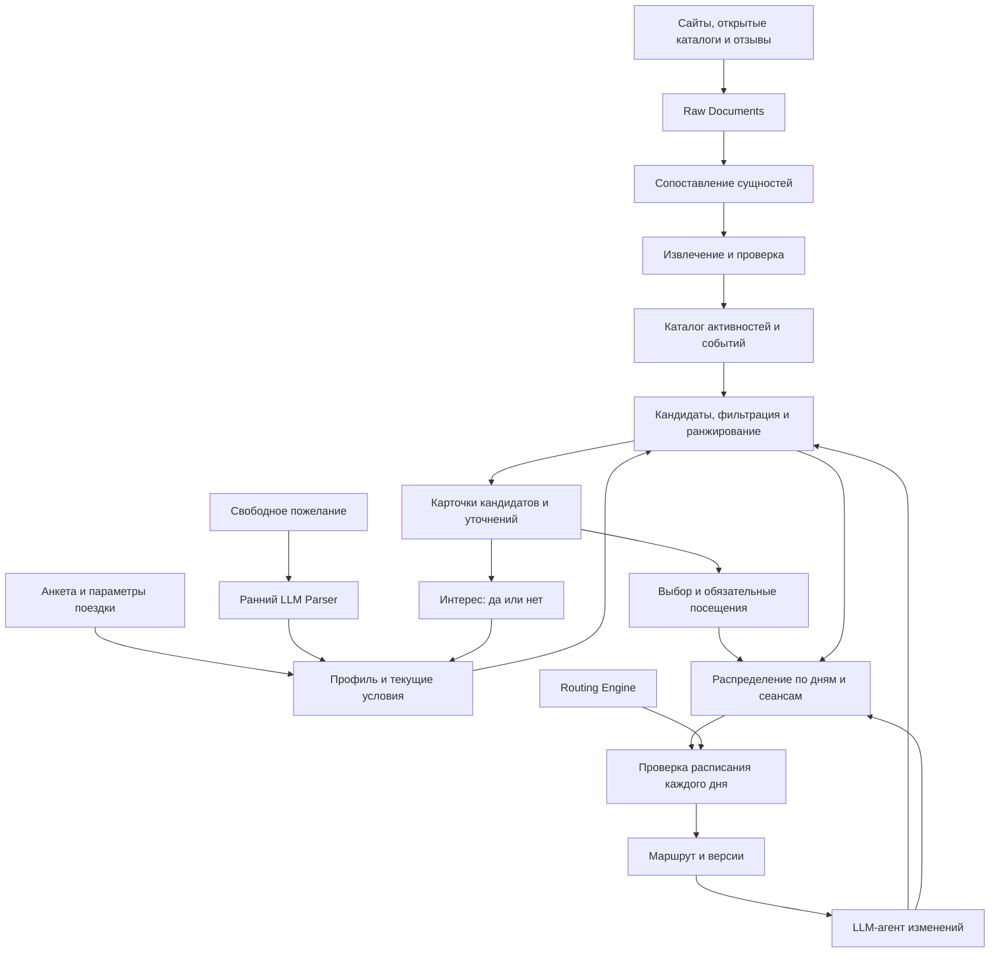

Актуальное уточнение 21.11.2026: вместимость ограничена только временем пользователя (до 3 ч, 4–5 ч, весь день), с учётом реальных OSM-переходов, посещений и сеансов. Километраж справочный. Старые упоминания лимитов ходьбы, возрастных норм и формулы M/P ниже отменены; см. [правила бюджета](planning_budget.md).

# Gorky Code — контекст, AI/ML-архитектура и интеграционные договорённости

Дата среза: **20 ноября 2026 года**. Версия документа: **0.2**.

Назначение: единая точка входа для разработчиков Backend, Data, ML/RecSys, LLM, Planner и Frontend. Документ объединяет исходный контекст проекта и последующие обсуждения. Его можно передать новому участнику команды или AI-ассистенту.

Это **рабочий проект архитектуры, а не утверждённое ТЗ**. Названия полей, API, веса, объёмы выборок и технологический стек ниже являются предложениями, если явно не указано иное. Реализации и обучения в рамках обсуждения ещё не выполнены.

## Оглавление

1. [Продукт и актуальный фокус](#1-продукт-и-актуальный-фокус)
2. [Статусы решений и изменения концепции](#2-статусы-решений-и-изменения-концепции)
3. [Пользовательский путь](#3-пользовательский-путь)
4. [Архитектура и границы модулей](#4-архитектура-и-границы-модулей)
5. [Источники и подготовка данных](#5-источники-и-подготовка-данных)
6. [Сущности и модель доказательств](#6-сущности-и-модель-доказательств)
7. [Пространства признаков](#7-пространства-признаков)
8. [Возрастная релевантность](#8-возрастная-релевантность)
9. [Карточки и профиль интересов](#9-карточки-и-профиль-интересов)
10. [Рекомендации и разнообразие](#10-рекомендации-и-разнообразие)
11. [Маршрут и ресторанный слот](#11-маршрут-и-ресторанный-слот)
12. [LLM: извлечение, ранний парсер и последующий агент](#12-llm-извлечение-ранний-парсер-и-последующий-агент)
13. [Обучение, SSL и архитектуры моделей](#13-обучение-ssl-и-архитектуры-моделей)
14. [Датасеты и применимость](#14-датасеты-и-применимость)
15. [Эксперименты и оценка](#15-эксперименты-и-оценка)
16. [Предлагаемые Backend API и DTO](#16-предлагаемые-backend-api-и-dto)
17. [Согласования между командами](#17-согласования-между-командами)
18. [Хранение, версии и события](#18-хранение-версии-и-события)
19. [План реализации](#19-план-реализации)
20. [Открытые вопросы, риски и дополнительные идеи](#20-открытые-вопросы-риски-и-дополнительные-идеи)
21. [Источники и правила продолжения работы](#21-источники-и-правила-продолжения-работы)

## 1. Продукт и актуальный фокус

Рабочее название исходного концепта: **«Доступный Нижний»**. География: Нижний Новгород. Аудитория: семьи с детьми, планирующие несколько часов, день или несколько дней в городе. Маршруты между городами не являются основной задачей.

Ценность: узнать состав семьи, интересы и условия поездки; подобрать реальные активности; собрать выполнимый план; позволить менять его на ходу без повторной анкеты.

**Последнее явное продуктовое уточнение:** основной критерий — возрастная релевантность **самому младшему ребёнку**. Коляска и доступность среды больше не являются центральным принципом рекомендаций. Затем пользователь попросил широкие пространства удобств, релевантности и интересов. Поэтому:

- возрастная пригодность младшему — основной критерий;
- интересы семьи — персонализация через карточки;
- удобства — дополнительные описательные признаки и предпочтения по запросу;
- наличие коляски не подразумевается у каждой семьи и не создаёт обязательного фильтра автоматически;
- время, часы работы, старт и финиш остаются условиями поездки;
- все явно заданные обязательные условия сохраняют силу.

Термин «репрезентативность для ребёнка» в обсуждении интерпретирован как **возрастная релевантность**: сможет ли младший понимать происходящее, участвовать и заинтересоваться. Это не статистическая репрезентативность выборки.

Три логических ядра: **RecSys выбирает, что интересно и подходит; Planner распределяет посещения по дням и проверяет выполнимость; LLM разбирает пожелания и помогает менять план разговором**. Routing Engine отдельно строит пути между точками. Ранний LLM-парсер может работать до карточек; он переводит явный запрос в параметры, а не придумывает профиль.

### Изменения версии 0.2 после сопоставления с доской

- Вход дополнен свободным пожеланием до рекомендаций и ранним LLM-парсером.
- Разделены сигналы «интересно», «неинтересно», «добавить» и «обязательно посетить».
- Приоритет текущего промпта относится к предпочтениям и не отменяет обязательные условия.
- Кандидаты из промпта, профиля, популярных мест и событий объединяются до общего отбора.
- Многодневный Planner использует фиксированные события как временные опоры; географические группы корректируются по выполнимости дней.
- Минимизация площадей многоугольников не используется как цель маршрутизации.
- Расписание рассчитывается в конкретных временах; UI может показывать преимущественно длительности.
- Дополнительные места ищутся вдоль пути с расчётом вставки и последствий для остатка дня.
- Эти изменения приняты пользователем для обновления рабочего документа; конкретные DTO, алгоритмы и владельцы по-прежнему требуют технического согласования.

## 2. Статусы решений и изменения концепции

Метки:

- **[Уточнение пользователя]** — прямое актуальное указание в беседе.
- **[Исходный контекст]** — положение из `vildan_context.md`; может требовать пересмотра после новых уточнений.
- **[Предложение]** — архитектурный или алгоритмический вариант для проверки.
- **[Исследовано]** — найдены первичные публикации/документация; это не означает скачивание и аудит набора.
- **[Согласовать]** — вопрос без принятого решения.

| Положение | Статус |
| --- | --- |
| Карточки выбора кандидатов и адаптивное уточнение интересов | Актуализированный flow после доски; обязательность опроса согласовать |
| Профиль не создаётся догадками LLM; ранний parser разрешён для явного запроса | Уточнение после сравнения с доской; агент изменения маршрута работает позднее |
| Главный возрастной ориентир — младший ребёнок | Уточнение пользователя |
| Нужны богатые пространства интересов, релевантности и удобств | Уточнение пользователя |
| Данные обогащаются из разных сайтов и отзывов | Цель пользователя; конкретные доступы проверяются отдельно |
| Разделение Recommendation / Planner / Routing / Trip Management | Исходный контекст и предлагаемая архитектура |
| Content-based как baseline, затем обучаемый агрегатор | Предложение, а не уже обученная модель |
| SSL как дополнительное обучение представлений | Предложение для эксперимента |
| Preview → подтверждение → сохранение изменения маршрута | Исходный продуктовый flow; техническую реализацию согласовать |
| Многодневное распределение с временными опорами событий | Принятая корректировка pipeline; алгоритм не утверждён |
| Дорога из другого города | Упомянута на доске; расширение scope, не включено автоматически |
| Go, Python, PostgreSQL/PostGIS, OR-Tools, GraphHopper | Кандидаты, стек не утверждён |

Ранее центральной была доступность для коляски. Это сохранено как исторический контекст, но не должно автоматически возвращаться в текущий MVP. Ранее обсуждалась агрегация возрастной пригодности всех детей; после уточнения основной возрастной score относится к младшему. Если обязательные ограничения заданы для других участников, они также соблюдаются.

## 3. Пользовательский путь

1. Вход: «Собрать поездку» либо адаптировать готовый маршрут.
2. Анкета семьи: возраст каждого ребёнка, интересы ребёнка/родителя по явным ответам. Отдельно параметры новой поездки: даты, количество дней, дневные окна, старт/финиш и темп.
3. Необязательное свободное пожелание: «животные и что-нибудь своими руками». LLM Parser переводит текст в структурированные предпочтения и условия. Неоднозначные обязательные параметры уточняются.
4. Backend объединяет анкету, текущий запрос и сохранённый профиль по правилам приоритета.
5. RecSys объединяет кандидатов из запроса, интересов, популярных мест и событий; применяет общую возрастную фильтрацию, ранжирование и разнообразие.
6. UI показывает карточки кандидатов. Пользователь может отдельно оценить интерес, добавить в поездку и отметить обязательность. Эти действия не являются одной меткой.
7. Если предпочтений мало, предлагается короткий адаптивный опрос да/нет; карточки уточнения не обязаны блокировать построение первого плана. После ответов кандидаты обновляются.
8. Planner выбирает сеансы фиксированных событий, распределяет остальные активности по дням и рассчитывает каждый день с Routing. Необязательные события могут быть исключены; обязательные не теряются молча.
9. Проверяются часы, длительности, переходы, дневная ходьба, перерывы и дедлайны. При перегрузке система объясняет, что не помещается, и предлагает варианты сокращения.
10. UI показывает дни, карту, длительности и «Что мы учли»; точные часы можно раскрывать по необходимости. Без известного старта план помечается предварительным.
11. LLM-агент подключается к готовому плану: «замени музей парком», «мы устали», «найди кафе по пути».
12. RecSys/Planner рассчитывают изменения и последствия для остатка дня → preview → подтверждение → новая версия маршрута.
13. Feedback, выбор, обязательность и исключения сохраняются раздельно для обучения.

Формулировка preference-карточки: «Хотели бы посетить эту активность в этой поездке?». Ответ родителя за семью — семейное предпочтение; он не даёт автоматически отдельных профилей каждого ребёнка. Положительный интерес не равен обещанию включить объект в маршрут.

## 4. Архитектура и границы модулей



| Модуль | Вход | Выход | Граница |
| --- | --- | --- | --- |
| Source Discovery / Ingestion | Seed POI, URL, источник | Raw документы | Не решает, понравится ли объект семье |
| Entity Resolution | Записи источников и каталог | Match / no-match / unresolved | Не переносит факты между неоднозначными филиалами |
| Extraction | Документ, схема атрибутов | Кандидатные claims с фрагментами | Не утверждает истинность только из уверенности LLM |
| Validation / Catalog | Claims, источники | Нормализованные признаки, статусы, evidence | Не создаёт missing → yes |
| Card Policy | Профиль, каталог, история | Карточки кандидатов или уточнений | Разные режимы и события интереса/выбора |
| Profile Model | Анкета, ответы | Веса/представления интересов | Не меняет явно заданные обязательные условия по свайпам |
| Recommendation | Профиль, контекст, каталог | Кандидаты, utility, причины | Не сохраняет маршрут и не строит дорожную геометрию |
| Request Parser / Context Resolver | Свободный текст, анкета, текущие условия | Типизированный запрос и provenance предпочтений | Не отменяет ограничения неявной интерпретацией |
| Selection State | Действия пользователя | Выбранные, обязательные, исключённые активности | Отдельно от весов интересов и сохранённого маршрута |
| Planner | Кандидаты, выбор, события, дневные условия, переходы | Распределение по дням, порядок и расписание | Проверяет совместную выполнимость, корректирует географические группы |
| Routing | Координаты, режим передвижения | Время, расстояние, геометрия | Не оценивает интересность |
| Trip Management / Backend | Команды и preview | Авторизованное версионное состояние | Владеет сохранением и конфликтами |
| LLM Agent | Запрос, профиль, текущий маршрут | Структурированные действия, объяснение | Использует инструменты, не прямой SQL |
| Frontend | DTO | Карточки, выбор, карта, подтверждение | Не воспроизводит ML-логику независимо от backend |

**Предложение по развёртыванию:** модульный backend, а не обязательная сеть микросервисов. Python удобен для NLP/ML/оптимизации. Если основной backend на Go, связь через HTTP/gRPC и общие схемы. Разделение процессов определяется командой и нагрузкой.

## 5. Источники и подготовка данных

### 5.1. Источники и их роль

| Источник | Что получать | Ограничение / статус |
| --- | --- | --- |
| OSM / Overpass / Geofabrik | География, категории, имеющиеся теги, дорожный граф | Не готовый набор возрастной пригодности |
| Официальные сайты объектов | Активности, возрастные правила, цена, расписание, описание | Проверять конкретный вариант посещения и дату |
| Культура.РФ | Описания, события, программы | Доступ к нужным API и права не подтверждены автоматически |
| VISIT-NN / туристические порталы | Темы, достопримечательности, маршруты | Подключать в рамках доступных условий источника |
| Дирекция парков / семейные навигаторы | Активности, площадки, зоны | Возраст оборудования не равен запрету входа в парк |
| Foursquare OS Places | Дополнительные POI, категории, сайты | Покрытие Нижнего не измерено; не путать с платными атрибутами |
| Geo Reviews 2023 | Русские отзывы, аспекты, исторические наблюдения | Январь–июль 2023; локальное покрытие требует аудита |
| Актуальные разрешённые отзывы | Опыт посещения и мнения | Доступ и повторное использование проверяются отдельно |
| Датасет Gorky Code | Возможные актуальные локальные сведения | В беседе содержимое и схема не предоставлены |
| Яндекс / 2ГИС live-карточки | Возможный дополнительный feed | На доске команды отмечены проблемы доступа/условий; не обязательная зависимость MVP |
| Реестры доступности | Дополнительные подтверждения удобств | Не центральный слой текущей концепции; покрытие не доказано |
| KidsReview | Семейные описания | В исходном исследовании отмечены ограничения; массовый парсер не считать разрешённым |

Стикеры с ответами сервисов отражают результаты обращения команды, а не универсальный пересказ актуальных тарифов. До интеграции проверить условия конкретного продукта. Обход отказа доступом через скрейпинг не является архитектурным решением.

В исходном контексте упоминался аудит: 1 092 POI в исследованной центральной области, 819 с названием; пилот 40 случайных POI, около 28 уверенных внешних сопоставлений. Это **пересказ прежнего среза**, не текущий подсчёт по всему городу. Эти исходные таблицы в текущей работе не изучались. Случайные аптеки и памятники не заменяют репрезентативный каталог детских активностей.

### 5.2. Pipeline ingestion

1. Реестр источников: тип, условия хранения/использования, лицензия, частота обновления, ответственный адаптер.
2. Получение доступных HTML/JSON/PDF/выгрузок.
3. Сохранение raw-версии, URL, fetch time, content hash — если это допускает источник.
4. Извлечение основного текста, таблиц и структурированных полей. Сначала JSON-LD/таблицы/шаблонные правила; LLM — для свободного текста.
5. Сопоставление организации, филиала, активности и события. Неоднозначность остаётся `unresolved`.
6. Извлечение атомарных claims с цитатой или offsets.
7. Нормализация возраста, денег, времени, категорий и единиц.
8. Проверка противоречий, актуальности и области действия.
9. Публикация версии каталога; расчёт feature vectors и embeddings.
10. Отчёт покрытия: сколько объектов и атрибутов известно, неизвестно, конфликтует, устарело.

Повторная обработка документа должна быть идемпотентной по документу, hash и версии extractor. Enrichment выполняется заранее; онлайн-рекомендация не запускает массовый веб-поиск для каждого пользователя.

## 6. Сущности и модель доказательств

| Сущность | Назначение |
| --- | --- |
| `Source` | Правила источника, лицензия, тип и адаптер |
| `RawDocument` | Конкретная версия страницы, текста или записи |
| `Place` | Физический объект: музей, парк, кафе |
| `Activity` | Вариант посещения: осмотр, экскурсия, лепка, кормление |
| `EventOccurrence` | Конкретный сеанс/дата активности |
| `Offer` | Тариф, семейный билет, услуга |
| `EntityMatch` | Связь записи источника с канонической сущностью |
| `Claim` | Извлечённое утверждение, ещё не обязательно подтверждённый факт |
| `Evidence` | Исходный фрагмент и его provenance |
| `ResolvedAttribute` | Итоговое значение признака с состоянием и evidence |
| `FeatureSnapshot` | Признаки и embeddings определённой версии |

Базовая единица рекомендации — **Activity / вариант посещения**, имеющая `place_id`. Чтобы не предложить несколько взаимоисключающих посещений одного места, Planner получает связи между вариантами и правила их совместимости.

### 6.1. Разделять факты, сообщения посетителей и выводы

`claim_type`: `official_statement`, `visitor_report`, `model_inference`, `manual_verification`.

`knowledge_status`: `known`, `unknown`, `conflicting`. Актуальность хранить отдельно: `fresh`, `stale`, `not_assessed`.

Для булевого признака: `true / false / null`; null означает неизвестное. Не надо создавать единую шкалу, где отсутствие источника становится нулём качества.

```json
{
  "claim_id": "claim-demo-1",
  "entity_type": "activity",
  "entity_id": "activity-demo-1",
  "attribute": "recommended_age_min",
  "value": 4,
  "claim_type": "official_statement",
  "evidence": {
    "document_id": "document-demo-1",
    "text_span": "Занятие рекомендовано детям от 4 лет",
    "source_url": "https://example.org/program",
    "published_at": null,
    "fetched_at": "2026-11-20T08:00:00Z"
  },
  "extraction_confidence": null,
  "validation_status": "pending_review"
}
```

Пример синтетический. Уверенность extractor не равна достоверности источника и не является калиброванной вероятностью без отдельной проверки.

Отзыв «стульчиков не заметили» не подтверждает их отсутствие. «Дочке четырёх лет понравилось кормление» — наблюдение одной семьи, не универсальная возрастная оценка. «0+» не доказывает интересность младшему. Программа 6+ не делает весь музей объектом 6+.

## 7. Пространства признаков

Цель — богатое, но измеримое описание. Не все признаки обязаны быть заполнены. Нужны словарь, определения, типы, применимость по категориям, evidence и маски известности.

| Пространство | Примеры осей |
| --- | --- |
| Тематика | Животные, растения, природа, космос, наука, техника, транспорт, история, архитектура, искусство, музыка, театр, литература, ремёсла, кулинария, спорт |
| Действия ребёнка | Смотреть, слушать, трогать, экспериментировать, собирать, рисовать, лепить, кормить, искать, решать загадки, бегать, лазать |
| Возраст и навыки | Рекомендованный возраст, обязательный порог, необходимость читать, понимать рассказ, выполнять инструкции, участие взрослого |
| Формат | Свободное посещение, экскурсия, спектакль, мастер-класс, квест, прогулка, демонстрация, контактная активность |
| Нагрузка | Длительность, ожидание, сидячий формат, физическая активность, возможность закончить раньше |
| Среда | Внутри/снаружи, шум, темнота, интенсивные эффекты, открытое пространство, погода |
| Удобства | Туалет, отдых, кафе, вода, детское меню, стульчики, пеленальная, хранение вещей, парковка |
| Организация | Цена, семейные тарифы, запись, сеансы, сезонность, дни работы, отмены |
| Характер впечатления | Познавательное, игровое, творческое, спокойное, активное, зрелищное — после определения критериев |
| Мнения | Интересность по возрастному контексту, понятность, проведение, очереди, переполненность, соответствие описанию |
| География | Координаты, район, близость к текущему маршруту, время перехода |
| Семантический embedding | Сходство текстов и тем, ещё не покрытых словарём |

Разделять:

- **интерес** — привлекательность содержания для семьи;
- **релевантность** — пригодность для младшего и текущего запроса;
- **удобства** — дополнительные потребности и предпочтения;
- **качество данных** — насколько обоснована оценка;
- **разнообразие** — свойства набора рекомендаций, а не только одного объекта.

Представление активности:

$$
x_i=[x_i^{topics},x_i^{actions},x_i^{age},x_i^{environment},x_i^{amenities},z_i^{text}].
$$

Каждый блок имеет маску известности и свою нормализацию. Нельзя без обучения просто склеить 1024-мерный embedding и несколько тегов и считать евклидово расстояние осмысленной общей метрикой. Нужны отдельные scores либо обученные проекции и масштабирование.

Каталог признаков расширять по реальным данным: собирать непокрытые формулировки, группировать, предлагать новые категории, проверять человеком, версионировать. LLM не добавляет новые теги в production-словарь бесконтрольно.

## 8. Возрастная релевантность

$$a_{min}=\min(a_1,\ldots,a_n).$$

Если детей нет, возраст не указан или массив пуст, это отдельный сценарий; нельзя вычислять фиктивный возраст. Точные возрастные единицы и обработку детей младше года согласовать.

Различать:

1. Обязательное условие участия: «строго от 6 лет».
2. Рекомендацию организатора: «лучше для 6–9 лет».
3. Контентную маркировку.
4. Мнение посетителя о ребёнке определённого возраста.
5. Предсказание модели пригодности.

Строгий порог проверяется до ранжирования. Мягкая пригодность может учитывать формат, длительность, участие, навыки и наблюдения. Это гипотезы признаков, не автоматические нормы развития ребёнка.

$$A(a_{min},i)=\text{оценка пригодности активности для младшего}.$$

Если пригодность — главное условие продукта, одного большого веса в сумме недостаточно: высокое совпадение интересов не должно компенсировать известную несовместимость. Предложение: слой обязательных возрастных правил и отдельная политика по неподтверждённой пригодности; порог мягкой пригодности проверять на разметке.

Собственная разметка: пары «возраст/возрастная группа — активность», оценка пригодности, причина, уверенность/недостаточно данных, источник. Возможные оценщики — родители и специалисты; предусмотреть расхождения оценок. Отсутствие общего открытого датасета не компенсировать генерацией якобы реальных оценок детей.

Ранее предложенная агрегация для всех детей:

$$A_{family}=\rho\min_k a_{ik}+(1-\rho)\sum_k\omega_k a_{ik}.$$

Это **альтернатива из прежней концепции**, не текущая основная формула. Её возвращение требует продуктового решения.

## 9. Карточки и профиль интересов

### 9.1. Назначения карточек и семантика действий

1. **Карточка кандидата:** предлагает реальную активность; допускает выбор посещения.
2. **Карточка уточнения интереса:** да/нет на активность или отдельный признак; нужна для персонализации, не является обязательной точкой.
3. **Стикер источника на доске:** исследовательский контекст, не пользовательский feedback.

| Действие | Эффект |
| --- | --- |
| «Интересно» | Положительный сигнал интереса; не создаёт обязательную остановку |
| «Неинтересно» | Отказ от активности; осторожный тематический перенос |
| «Добавить в поездку» | Предпочтительное посещение, которое Planner пытается включить |
| «Обязательно посетить» | Явная обязательная точка; при конфликте вернуть infeasible/уточнение |
| «Убрать из выбора» | Изменение списка; не автоматическая антипатия |
| Пропуск или отсутствие выбора | Не отрицательная метка |

Конкретные кнопки и их сочетание на одной карточке согласовать с UX. Важен раздельный backend-смысл. Если API поддерживает `set_required`, true может одновременно добавлять активность в выбор, но это должно быть явно определено.

При достаточном запросе сначала показываем кандидатов. При недостаточном профиле предлагаем уточнение; возвращение к опросу после первого списка допустимо. Для activity-карточки хранить ID, заголовок, описание, изображение с правами, `card_revision`, `card_mode`, возрастную информацию и источник кандидата. Версия оформления нужна для интерпретации ответов.

### 9.2. Профиль

$$S_t=(P,\theta_t,C_t,R_t,H_t),$$

где P — семья и явные условия, theta — интересы, C — контекст, R — маршрут, H — история. Список выбранных/обязательных активностей хранится отдельно как Selection State, а не выводится из положительных ответов.

Постоянный профиль и предпочтения текущей поездки хранить раздельно. «Сегодня хотим природу» — trip preference; «запомни, мы предпочитаем парки» — кандидат на постоянное изменение.

### 9.3. Приоритет источников предпочтений

Обязательные условия применяются независимо от ранжирования: возрастные пороги, даты, дедлайн и другие явно заданные требования. Для мягких предпочтений предлагаем приоритет: текущий прямой запрос → актуальные ответы карточек → сохранённая анкета → популярность как prior. Это правило для разрешения противоречий, а не инструкция игнорировать остальные источники.

«Сегодня хотим животных» может изменить тематический приоритет, но не отменяет возраст. «Ошибся, ребёнку 7 лет» — явная поправка профиля и отдельная проверяемая мутация. Каждое предпочтение имеет provenance, scope и время; позднее явное исправление важнее прежней записи. Если история сессии противоречит прямому запросу, можно уточнить, а не скрыто перезаписать его.

### 9.4. Простой baseline

Для интерпретируемых тематических признаков:

$$\hat p_{ui}=\sigma(\theta_u^\top x_i+b),\qquad \sigma(z)=1/(1+e^{-z}).$$

$$\theta_{t+1}=\theta_t+\eta[(y_t-\hat p_{ui})x_i-\lambda(\theta_t-\theta_0)].$$

Это предложенная онлайн-логистическая адаптация интересов. Начальный профиль — из анкеты либо нейтральный prior. Score не называть измеренной вероятностью удовольствия после посещения.

Отказ: «уже были», «дорого», «не сегодня», «не нравится тема» — разные причины. Сохранять отказ от конкретной активности отдельно; тематический перенос делать умеренным. Отсутствие ответа и непоказанный объект не являются отрицательными метками.

### 9.5. Выбор следующей уточняющей карточки

Первый набор покрывает разные темы и действия. Далее сочетать интерес, уточнение профиля и неповторяемость:

$$i_{next}=\arg\max_i[\alpha\hat p_{ui}+\beta4\hat p_{ui}(1-\hat p_{ui})-\gamma\max_{j\in H}\operatorname{sim}(i,j)].$$

Это эвристика: неопределённость ответа около 0.5 не гарантирует максимальный информационный выигрыш. Сравнивать с фиксированным разнообразным и случайным опросом. Лимит карточек, остановку, возможность пропуска и необязательную причину согласовать.

## 10. Рекомендации и разнообразие

### 10.1. Отбор и score

Кандидатные источники работают совместно:

$$C=C_{query}\cup C_{interests}\cup C_{popular}\cup C_{events}.$$

Затем дедупликация → общие обязательные правила для всех источников → возрастная оценка → интересы и контекст → разнообразие → карточки и пул Planner. Дешёвые обязательные фильтры можно применять уже при retrieval, но ни один источник их не обходит. Точная открытость на время прибытия проверяется в Planner.

Популярность не идёт перед возрастной пригодностью. Когда прямой запрос ничего не нашёл, вернуть это явно и предложить расширить подбор; не подменять его молча топом города. Кандидату можно приписать несколько origins; отсутствие алгоритма «нейросеть» не мешает работать baseline retrieval/ranking.

$$U(u,i)=w_A A(a_{min},i)+w_T T(u,i)+w_F F(u,i)+w_E E(u,i)+w_M M(u,i).$$

- A: возрастная релевантность.
- T: темы.
- F: действия и формат.
- E: среда и нагрузка относительно предпочтений.
- M: явно запрошенные удобства.

Все веса — параметры для проверки, не утверждённые числа. В ранних вариантах также обсуждались отдельные штрафы стоимости, неизвестных данных, отклонения от маршрута и совпадение свободного запроса. Их можно включать в контекстный ranker с прозрачными компонентами.

Не штрафовать объект за все неизвестные удобства, если пользователь их не запрашивал: это может необоснованно продвигать лучше описанные места. Для критичных неизвестных нужна явная политика; для мягких — missing-aware модель и предупреждения.

### 10.2. Разнообразие

$$Select(i)=\lambda U(u,i)-(1-\lambda)\max_{j\in S}\operatorname{sim}(i,j).$$

Это предложенный MMR-подобный reranking. Сходство должно учитывать темы/форматы, а не только категорию Place. Применять среди подходящих кандидатов. Дополнительно можно проверять покрытие интересов, смену активного/спокойного формата, повтор посещения одного Place.

Разнообразие карточек нужно для изучения предпочтений; разнообразие рекомендаций — для качества списка; разнообразие маршрута — для выполнимого сочетания впечатлений. Эти цели связаны, но не тождественны.

### 10.3. Объяснения

Возвращать `matched_reasons`, `applied_constraints`, `warnings`, `unknown_attributes`, `evidence_refs`, `score_components`. Причины основаны на фактически применённых признаках. Географическое объяснение «по пути, +5 минут» допускается только после расчёта. Не выдумывать удобства и рейтинги для красивого текста.

## 11. Маршрут и ресторанный слот

$$R=(s,i_1,\ldots,i_m,f),$$

$$R^*=\arg\max_{R\in\mathcal F(P,C)}[\sum_{i\in V(R)}U(u,i)+\mu Diversity(R)-\nu T_{move}(R)/T_{available}-\xi Fatigue(R)].$$

Это семейство Orienteering with Time Windows. `Fatigue` пока гипотеза и требует определения. Базовую реализацию можно начать без него, задав длительности, перерывы и лимит ходьбы явными параметрами.

Временные условия:

$$t_{j+1}\ge t_j+d_{i_j}+\tau_{i_j,i_{j+1}}+b_j,$$
$$o_i\le t_i,\quad t_i+d_i\le c_i,\quad t_f\le deadline.$$

Плюс обязательные точки, сеансы, совместимость вариантов одного места. Несколько интервалов работы и разрывы расписания требуют выбора соответствующего окна. Неизвестные часы/длительности обрабатывать по согласованному fallback с предупреждением.

Planner получает пул, а не только top-3. Матрица переходов — из Routing Engine; геометрическое расстояние допустимо для предварительного отсева, но не как точное время по улицам. OR-Tools — кандидат для реализации, GraphHopper — кандидат для маршрутизации; оба не являются автоматически готовым семейным планировщиком.

### 11.1. Распределение по дням

Для каждого дня задать дату, timezone, начало/окончание окна, старт/финиш (например, отель), режим передвижения и лимиты. Не выводить все дневные окна только из общей продолжительности поездки.

1. Определить обязательные события и их occurrence/seance; проверить конфликты. Если допустимо несколько сеансов, Planner выбирает выполнимый вариант, а не закрепляет случайный.
2. Использовать выбранные события как временные опоры. Необязательное событие — кандидат, его нельзя автоматически делать обязательным.
3. Географически сгруппировать остальные активности как начальное приближение.
4. Заполнить промежутки и проверить каждый день по реальным переходам, посещениям, ожиданию и перерывам.
5. Перенести/заменить необязательные активности при перегрузке. Географические группы не являются неизменяемыми границами.
6. Предложить сокращения с объяснением, если выбранное не помещается. Обязательные точки не удаляются молча.

$$\sum_{i\in R_d}d_i+\sum_{(i,j)\in R_d}\tau_{ij}+T_{waiting,d}+T_{breaks,d}\le T_d.$$

$$D_{walk}(R_d)\le D_{max,d}.$$

Дневной лимит ходьбы — явный параметр/согласованный default с возможностью изменения, а не неподтверждённая медицинская норма возраста. Такси и другие режимы — отдельные варианты с собственной стоимостью и пересчётом, не автоматическая подмена ходьбы.

**Минимизация суммы площадей многоугольников отвергнута как цель.** Почти коллинеарные далёкие точки имеют малую площадь, но длинный путь. Использовать стоимость переходов и выполнимость. OSM — источник геоданных/графа; факт загрузки графа в память не выполняет распределение по дням и оптимизацию посещений.

### 11.2. Внутреннее расписание и отображение

Внутри вычисляются абсолютные времена прибытия и окончания с учётом даты, timezone и сеансов. UI может показывать преимущественно порядок и длительности, с раскрытием часов. Если старт неизвестен, вывод предварительный; совместимость с сеансами и закрытием не считается подтверждённой.

### 11.3. Ресторан в слот между A и B

Вход RecSys: категория, кухня при наличии, профиль, время/окно обеда, A/B, текущий план. Выход — реальные кандидаты. Planner проверяет вставку и всё последующее расписание:

$$\Delta T_i=\tau_{Ai}+d_i+\tau_{iB}-\tau_{AB}.$$

$$InsertScore(i)=U(u,i)-\kappa\Delta T_i/T_{slot}.$$

Кандидат может не поместиться в окно; это причина исключения, не отрицательный пользовательский интерес. При infeasible возвращать конфликт и допустимые варианты, не нарушать дедлайн молча.

### 11.4. Дополнительные места вдоль маршрута

Искать кандидатов в коридоре вокруг фактических legs, затем ранжировать по пригодности/интересам и рассчитывать вставку между соседними остановками. Коридор — retrieval-эвристика, не финальная гарантия малого отклонения. Поиск внутри многоугольника остановок не используется как критерий «по пути».

Перед показом последствий пересчитать остаток дня: добавленная прогулка и посещение могут изменить ожидание или доступность сеанса. В DTO разделять `delta_walking_seconds`, `added_visit_seconds`, `delta_waiting_seconds`, `delta_day_end_seconds` и конфликты. Числа возвращает Planner, LLM только объясняет их.

Дорога из другого города упомянута на доске как возможное расширение. Не добавлять её автоматически: нужен отдельный transit/intercity контур и решение Product. Текущий базовый scope — городская поездка.

## 12. LLM: извлечение, ранний парсер и последующий агент

### 12.1. Offline extraction

Документ + схема → claims + evidence. LLM может извлекать темы, возрастные формулировки, действия, аспекты отзывов; предлагать нормализацию и кандидатов новых тегов. Затем детерминированная валидация и выборочная ручная проверка.

Рабочая структура GigaChat-парсера, правила подачи URL, разделение часов работы/сеансов/длительности и формат `description` для RecSys зафиксированы в [`docs/site_parser.md`](site_parser.md).

Тексты сайтов — недоверенные данные, а не инструкции для инструментов. Extractor не получает право выполнять команды со страницы. Ограничивать объём, допустимые поля, enum, типы, evidence и возможность `unknown`.

### 12.2. Ранний Request Parser

Работает до рекомендаций, если пользователь ввёл свободное пожелание. Преобразует фразу в темы, действия, категории, предпочтения, явные требования и неоднозначности. Профиль и возраст берёт из анкеты; неизвестное не придумывает. Существование «парк рядом с отелем» проверяется через каталог/инструменты, а не память модели.

Выход parser валидируется backend: enum, типы, provenance, scope и conflicts. Context Resolver объединяет его с профилем по разделу 9.3. При изменении обязательных условий нужна ясная семантика явного исправления; неясность возвращается как `needs_clarification`.

Это не агент автономного построения расписания. Если пользователь не ввёл текст, parser пропускается; обычный путь по анкете и карточкам работает без него.

### 12.3. Online agent

Работает после профиля и первоначального маршрута. Получает версию поездки, минимальный нужный контекст, разрешённые инструменты.

Предложенные tools:

```text
get_trip_state(trip_id)
recommend_places(profile_id, profile_version, query, route_context)
preview_route_change(trip_id, expected_version, changes)
validate_route(candidate_route)
apply_route_change(trip_id, preview_id, expected_version)
```

Последний tool может вызываться только после продуктового подтверждения и backend-проверки; механизм подтверждения не определяется самим текстом LLM.

Запрос «убери второй музей и добавь парк» → intent → разрешение ссылки на конкретный stop → RecSys → Planner → preview → подтверждение → apply. Если музеев несколько и ссылка неразрешима, уточнение. Тексты «мы устали» меняют контекст темпа, а не постоянную любовь к музеям.

LLM не генерирует новые `place_id`, не придумывает расписание, не обращается к БД напрямую. Подход tool-use/ReAct — архитектурный ориентир, не требование показывать пользователю внутренние рассуждения модели. Голос при добавлении использует тот же intent pipeline после Speech-to-Text.

## 13. Обучение, SSL и архитектуры моделей

### 13.1. Три компонента обучения

$$z_i=f_\phi(text_i,features_i),$$
$$p_u=g_\psi(form_u,\{(z_i,y_{ui})\}),$$
$$\hat p_{ui}=\sigma(h_\omega(p_u,z_i,c_u)).$$

1. Энкодер активности: содержание и сходство.
2. Агрегатор пользователя: интересы по небольшому набору ответов.
3. Ranker: порядок кандидатов в конкретной поездке.

### 13.2. Обсуждённые архитектуры

| Вариант | Смысл | Когда применять |
| --- | --- | --- |
| Content-based | Совпадение признаков/embeddings активности и профиля | Первый baseline, cold start |
| EAR | Estimation → Action → Reflection: оценить интерес, выбрать вопрос/рекомендацию, обновиться | Архитектурный ориентир для адаптивных карточек |
| Mean positive-minus-negative | Среднее понравившихся представлений минус часть среднего отказов | Простой профиль без обучения агрегатора |
| DeepSets / attention pooling | Обучаемое агрегирование набора ответов | Есть разные пользователи и отложенные ответы |
| Multi-interest | Несколько интересов: природа, творчество, техника | Если один усреднённый вектор теряет разные направления |
| LightFM | Гибрид взаимодействий и метаданных | При собственных логах; явно выбрать loss и смысл отрицаний |
| CatBoostRanker | Учится сортировать по табличным признакам пары пользователь–активность | При размеченных показах/выборах и группах сессий |
| Two-tower | Отдельные энкодеры пользователя и объекта, быстрый retrieval | При масштабе каталога и достаточном обучающем сигнале |
| Последовательные модели | Учитывают упорядоченную историю поведения | Если порядок действительно содержит сигнал |
| Контекстный bandit | Баланс изучения интересов и привлекательности рекомендаций | После определения reward и корректного логирования политики |

Для mean baseline:

$$p_u=\operatorname{mean}_{i\in H^+}z_i-\alpha\operatorname{mean}_{j\in H^-}z_j.$$

Пустые группы пропускать, при отсутствии ответов — prior. Для multi-interest:

$$P_u=\{p_{u,1},\ldots,p_{u,K}\},\quad I(u,i)=\max_k sim(p_{u,k},z_i).$$

Это вариант, не фиксированная формула production. Малого числа ответов может не хватить для нескольких устойчивых интересов. Не приписывать каждый латентный вектор конкретному ребёнку без данных.

### 13.3. Support / Query обучение

Для каждого train-пользователя часть известных ответов — support, остальные — query. Модель строит профиль по support и предсказывает query. Пользователи train/validation/test не пересекаются. На query нельзя обучать профиль или выбирать гиперпараметры test.

$$L_{feedback}=-\sum_{(u,i)\in Q}[y_{ui}\log\hat p_{ui}+(1-y_{ui})\log(1-\hat p_{ui})].$$

Оценки интереса — явные supervised labels; выбор посещения и обязательность являются отдельными targets/events. `Maybe` — отдельная категория/задача либо исключается с отчётом; не превращать в `No` автоматически. Непоказанные объекты не считать отрицательными. Порядок карточек назначает приложение, поэтому set-encoder — разумный первый вариант.

### 13.4. SSL

SSL полезен для представлений, но не создаёт личных предпочтений из одних описаний.

- Текстовый contrastive SSL: две смыслосохраняющие версии одного текста или dropout-view; контролировать ложные отрицательные пары.
- Связь описания и проверенных атрибутов: обучение со слабым supervision из подготовленных признаков, а не независимая человеческая истина.
- TSDAE: восстановление исходного текста из повреждённого как доменная адаптация sentence embeddings.
- S³-Rec: самосупервизируемые связи признаков, объектов и частей истории.
- CL4SRec: контрастивное обучение аугментированных последовательностей взаимодействий.
- SGL / LightGCN: SSL на графе пользователь–объект при наличии достаточного графа взаимодействий.

Нельзя использовать каждый показ/отказ как положительную историю для S³-Rec/CL4SRec/SGL. Для нового пользователя без рёбер графа нужен отдельный путь через признаки и карточки.

Контрастивная функция:

$$L_{CL}=-\log\frac{\exp(sim(z_i^{(1)},z_i^{(2)})/\tau)}{\sum_j\exp(sim(z_i^{(1)},z_j^{(2)})/\tau)}.$$

Общая предложенная цель:

$$L=L_{feedback}+\lambda_{SSL}L_{SSL}+\lambda_{reg}L_{regularization}.$$

Аугментации не удаляют отрицания, возрастные пороги и обязательные условия. Две разные активности одного музея не автоматически положительная пара. Фото-векторы могут помочь тематическому поиску/оформлению, но по фото нельзя подтверждать возрастную пригодность или удобства. Визуальные SSL-модели не были выбраны как обязательный компонент.

### 13.5. Рекомендованный первый обучаемый вариант

Готовый мультиязычный text encoder → небольшой агрегатор ответов → supervised loss по карточкам. Отдельно интерпретируемая возрастная логика. SSL добавить ablation-экспериментом, сравнить с неизменённым encoder. Не начинать одновременно с графового SSL, text SSL и сложной последовательной модели.

## 14. Датасеты и применимость

Ниже — найденные источники, не полностью проверенные локальные копии. Просмотр описания/публикации не означает проверку архива, лицензии каждой компоненты, полноты и свежести. Наборы разных доменов не соединяются обычным join: IDs и пользователи у них разные.

| Набор | Что содержит / близость | Использование | Ограничение |
| --- | --- | --- | --- |
| **Stravl** | По README 80 301 путешественник, анкета, Yes/No/Maybe на карточки направлений, более миллиона свайпов | Главный внешний аналог профиля из анкеты и карточек | Направления, не POI; возраст 0–19 не разделяет маленьких детей; хронология требует проверки |
| **Geo Reviews 2023** | 500 000 отзывов об организациях России, название/адрес/рубрики/rating/text | Русский NLP, аспекты, словарь, историческое обогащение | Нет готовых меток удобств/возраста и стабильного POI ID в перечисленной схеме; 2023 год |
| **SemEval-2016 ABSA / Russian Restaurants** | Аспекты, упоминания и тональность ресторанных отзывов | Извлечение аспектов и полярности | Новые детские аспекты нужно разметить самим; доступ архивов проверить |
| **Should I Visit This Place?** | По статье около 2 000 отзывов о 1 000 местах, inclusion/exclusion по 11 факторам | Близкая задача извлечения ограничений и пригодности из отзывов | Статья доступна; архив и лицензия не подтверждены в сессии |
| **Fodors–Zagats / Machamp** | Пары ресторанных записей и labels совпадения | Entity Resolution benchmark | Другой язык/география; свои филиалы и адреса нужны для переноса |
| **SWDE / WebSRC** | HTML extraction / вопросы по страницам | Проверка извлечения структурированных значений; MarkupLM | Старые ссылки/архивы; не готовая семейная онтология |
| **EAR Yelp / LastFM** | Пользователи, объекты, атрибуты, среда интерактивных рекомендаций | Политика вопросов и обновления | Симулятор и не туристический домен для LastFM |
| **KuaiRec** | Видео и почти полностью наблюдаемая подматрица взаимодействий | Исследование интерактивной стратегии | Просмотр видео не равен туристическому swipe; proxy labels оговаривать |
| **Flickr / PersTour / travel_recommendation** | POI и траектории из геофотографий | Связка полезностей и маршрута, baselines | Косвенные посещения/длительности; не семейная выборка |
| **Foursquare NYC/Tokyo** | Чекины, время, координаты, категории 2012–2013 | Пространственно-временное поведение | Посещение не explicit like; старые города другого рынка |
| **Gowalla / Brightkite** | Геолокационные взаимодействия и сети | Дополнительный mobility/graph benchmark | Низкий приоритет для текущего MVP |
| **TripCraft** | Персоны, активности, перемещения, временные условия | Проверка персонализации и расписания | Не локальные данные Нижнего |
| **TravelPlanner** | По проектной странице 1 225 запросов и проверки ограничений | Инструменты/валидация LLM-планирования | Более широкий сценарий поездок, не готовый профиль по карточкам |
| **MovieLens Tag Genome 2021** | Степени соответствия фильмов множеству тегов | Аналог богатого item-tag пространства | Не туристическая модель и не детская пригодность |
| **Yelp Open Dataset** | Отзывы, пользователи, бизнес-метаданные | Дополнительный зарубежный baseline | Указаны academic-use ограничения; не подразумевать пригодность для продукта |
| **MIND** | Новости и логи рекомендаций | Общий recommendation benchmark | Ниже приоритета Stravl для вашего сценария |

Приоритет: **Stravl → Geo Reviews + собственная аспектная разметка → SemEval → свои активности/возрастные оценки → Flickr/TripCraft для Planner**. KuaiRec и MIND — вспомогательные, не основная обучающая база.

В README Stravl заявлено разрешение академического и коммерческого использования. В Geo Reviews опубликована MIT-лицензия; сохранять её условия. Для остальных наборов разрешения и работоспособность скачивания проверять отдельно. Даже открытые старые отзывы не становятся автоматически актуальными фактами о месте.

## 15. Эксперименты и оценка

### 15.1. Матрица экспериментов

| ID | Гипотеза / сравнение | Данные | Метрики |
| --- | --- | --- | --- |
| E01 | Правила vs LLM extraction | Проверенные страницы | Precision/recall значений, правильная сущность, evidence correctness |
| E02 | Правила ER vs парный классификатор | Свои пары + Fodors–Zagats | Match precision/recall, ошибочные объединения филиалов |
| E03 | Готовая ABSA vs дообучение | SemEval + ручные Geo Reviews | Span F1, macro-F1 аспектов/полярности, отрицания |
| E04 | Анкета/популярность vs content profile | Stravl | NDCG по известным меткам, качество бинарного прогноза |
| E05 | Mean profile vs обучаемый агрегатор | Support/query | Кривые качества после 1/3/5/10 ответов, где достаточно данных |
| E06 | Frozen encoder vs + SSL | Одинаковые users/splits и тексты | Те же recommendation metrics, cold-item test |
| E07 | Один интерес vs multi-interest | Достаточные истории | Relevance и покрытие интересов, устойчивость |
| E08 | Fixed diverse vs adaptive cards | Реальные показы или честная simulation | Ответов до полезного результата, качество, completion |
| E09 | Rules age vs обученная пригодность | Человеческие оценки возраст–активность | Согласие с оценщиками, false acceptance, abstention coverage |
| E10 | Без/с reranking разнообразия | Подходящие кандидаты | NDCG, intra-list diversity, покрытие тем/форматов |
| E11 | Greedy insertion vs оптимизатор | Локальные scenarios + Flickr | Feasible rate, utility, переходы, runtime |
| E12 | Команды LLM | Набор фраз с expected actions | Intent/slot accuracy, корректные tools/IDs, сохранение условий |

### 15.2. Разделение данных и защита от утечек

- Extraction: проверка на новых сайтах/шаблонах; не только случайные страницы одного шаблона.
- Отзывы: разносить организации и дубликаты текстов; evidence из test не использовать для train-labels.
- Cold-user: разные пользователи между train/validation/test.
- Cold-item: отдельные активности/места на test; семантически дублирующиеся варианты учитывать при split.
- Temporal: если есть настоящая хронология, отделять будущее и логировать время доступности признака.
- Метрики relevance считать с явным описанием кандидатного набора и наблюдаемости меток.
- Off-policy оценка требует подходящих логов и вероятностей показа; списков likes без exposure недостаточно.
- LLM-generated labels — silver, ручной holdout — gold; не оценивать качество только совпадением с teacher.
- Возрастную оценку, интерес, удобства и выполнимость маршрута оценивать отдельно, а не одной итоговой цифрой.

### 15.3. Пилотные объёмы

Обсуждались ориентиры **50–100 проверенных мест** и **20–30 семейных сценариев** для инженерной проверки. Это не расчёт мощности и не достаточность для доказательства качества ML. Число активностей может быть больше числа мест. Объём разметки и обучения определять после аудита покрытия и частот классов.

## 16. Предлагаемые Backend API и DTO

Все имена и структуры ниже — **черновик контракта**. Идентификаторы и значения в примерах синтетические.

### 16.1. Общие соглашения

- Канонические ID выдаёт backend/catalog; LLM не создаёт их.
- Различать `place_id`, `activity_id`, `occurrence_id`, `stop_id`; последний относится к посещению в конкретном маршруте.
- UTC timestamps в ISO 8601 и отдельный IANA timezone поездки. Для Нижнего обычно `Europe/Moscow`, но не хардкодить обработку всех времён в ML.
- Даты, локальные часы, timezone и расписание хранить типизированно; не передавать только строку «после обеда» в Planner.
- Единицы: `duration_seconds`, `distance_meters`; нули не использовать вместо missing.
- Передавать версии профиля, поездки, каталога, feature schema, модели и card policy.
- Все мутации с `request_id`/idempotency key, авторизацией backend и optimistic locking.
- Логи не содержат лишние персональные сведения, сырые промпты и ключи API по умолчанию.

### 16.2. Действующий проект HTTP-контракта v1

Основной машинный контракт — [openapi.json](contracts/openapi.json), бизнес-инварианты — [integration_contracts_v1.md](contracts/integration_contracts_v1.md). Форматы и пути из этих файлов имеют приоритет перед исследовательскими примерами в предыдущих разделах. В v1 профиль семьи хранится в `TripInput`, а не в отдельном ресурсе профиля; `trip_id`, `activity_id`, `stop_id` и `preview_id` используются как непрозрачные идентификаторы.

Публичные операции:

```text
GET  /api/v1/session
GET  /api/v1/reference-data
POST /api/v1/trips
GET  /api/v1/trips/{trip_id}
POST /api/v1/trips/{trip_id}/recommendations
POST /api/v1/trips/{trip_id}/previews
GET  /api/v1/trips/{trip_id}/previews/{preview_id}
POST /api/v1/trips/{trip_id}/previews/{preview_id}/apply
POST /api/v1/trips/{trip_id}/progress
POST /api/v1/trips/{trip_id}/needs
GET  /api/v1/map/places
GET  /api/v1/trips/{trip_id}/taxi-suggestions
```

Внутренние операции backend ↔ ML:

```text
POST /internal/v1/recommendations
GET  /internal/v1/catalog/activities
```

`POST /api/v1/trips` принимает `TripInput`: состав семьи, дни и ограничения по времени/ходьбе. Денежный бюджет поездки в v1 не передаётся и не проверяется. `duration_budget_sec` и `rest_budget_sec` — временные величины. Рекомендации, preview и применение используют состояние поездки и её версию. Preview имеет собственный `preview_id`; apply принимает этот ID в пути и не подменяет показанный план произвольным списком остановок.

Оценки интереса каждого ребёнка (`child_interest.value`) и взрослых (`adult_interest`) — неотрицательные числа без верхней границы, включая 0. `popularity` и `final_relevance` остаются нормированными в [0,1]. Нормирование при расчёте `final_relevance` выполняет ML по согласованной policy; возрастной запрет не компенсируется высоким интересом.

Возраст не требует отдельной модели интереса для каждой группы. ML оценивает пригодность конкретного места отдельно от интереса: у каждой активности свой профиль для групп 3–5, 6–8 и 9–11 лет, а возраст ребёнка выбирает соответствующее значение. Универсального множителя возрастной группы нет, поскольку он одинаково сдвигал бы все места и не описывал бы их пригодность. При неизвестной оценке сохраняется null; известный запрет проверяется до ранжирования. Интересы детей имеют равные веса, баланс количества активностей остаётся отдельным правилом.

### 16.3. Карточки и дальнейшие интерфейсы

В v1 карточка может отображать `Candidate`, а явный выбор или обязательность сохраняются в `TripInput.selections` через `update_trip_input` preview/apply. Ответ «интересно» не равен выбору активности. Отдельная сессия карточек, feedback и постоянный профиль интересов пока не входят в HTTP-контракт. Их DTO и пути надо согласовать перед реализацией обучения по ответам; существующие пути v1 от этого не меняются.

Ранний разбор свободного текста, отдельное хранение профиля, агент и детальный журнал событий остаются направлениями развития. Их нельзя считать реализованными endpoints v1. Все ошибки v1 используют `ApiError` из OpenAPI.

## 17. Согласования между командами

| Участники | Что зафиксировать | Проверяемый результат |
| --- | --- | --- |
| Product + ML | Различия interest/select/required, субъект ответа, смысл возраста младшего, приоритет промпта | Единая инструкция и примеры |
| Data + Backend | Сущности, ID, schema, raw retention, версии и publication каталога | Валидируемый fixture каталога |
| Data + ML | Словарь признаков, unknown, evidence, silver/gold | Feature contract и размеченный holdout |
| Backend + RecSys | Вход профиля/контекста, latency budget, batch/pool, шкалы score | Endpoint и воспроизводимые примеры |
| RecSys + Planner | Candidate origins, шкалы utility, selections/required, сеансы, дневные окна, перенос между группами | Контракт candidates и сценарии конфликтов/перегрузки дней |
| Planner + Routing | Профиль передвижения, матрицы, кэш, единицы, геометрия | Известный маршрут с проверенными временами |
| Backend + LLM | Ранний parser vs поздний агент, provenance/приоритеты, tools, IDs, clarify/preview/apply | Запросы до маршрута и команды после с ожидаемыми действиями |
| Frontend + Backend | Версии карточек, feedback idempotency, warnings, preview UX | Один сквозной сценарий |
| Backend + ML Ops | Модель, схема признаков, совместимость, fallback | Версионированный deploy и rollback |
| Все владельцы | Ответственный за источник истины и изменение каждого ресурса | RACI/список ответственных, без дублирования записи |

Распределение исходной доски не означает, что Вильдан единолично пишет ingestion, frontend, Routing и Planner. Его фокус в исходном контексте: профиль/релевантность/рекомендации, объяснения, ресторанный слот и интеграция LLM; реальные владельцы уточняются командой. Новое изменение фокуса на младшего отразить в backlog и критериях приёмки.

## 18. Хранение, версии и события

### 18.1. Предлагаемые слои

- Raw storage: доступные исходные версии документов, hashes, provenance.
- Нормализованная БД: места, активности, события, источники, claims/evidence.
- Feature layer: нормализованные признаки, маски, embeddings, schema/model version.
- Product state: профили, сессии карточек, поездки, previews, версии маршрутов.
- Event log: показы, ответы, рекомендации, выборы, изменения.
- ML artifacts: датасетные snapshots, splits, конфиги, checkpoints, evaluation reports.

PostgreSQL/PostGIS и object storage — кандидаты. Векторное хранилище/индекс добавлять по объёму, а не обязательно выделять отдельную систему для маленького каталога.

### 18.2. События, которые нельзя смешивать

`card_impression`, `card_answer`, `recommendation_impression`, `activity_selected`, `activity_deselected`, `activity_requirement_changed`, `initial_query_parsed`, `context_resolved`, `activity_excluded_by_constraint`, `stop_added`, `stop_removed`, `route_preview_created`, `route_applied`, `visit_feedback`.

Минимальные поля: event_id, request_id, UTC time, user/profile/trip/session IDs, соответствующие versions, entity IDs, action/value/reason, policy/model/catalog version. Для стратегии показов — доступный candidate set или восстановимый reference и вероятность выбора, если она определена политикой. Не придумывать propensity постфактум для детерминированного/неизвестного logger.

Непоказано ≠ пропущено ≠ отказ ≠ исключено по времени ≠ удалено из-за усталости. Эти различия критичны для обучения.

### 18.3. Воспроизводимость

Каждая рекомендация сохраняет reference на профиль/каталог/модель. Каждая поездка — версию результата Planner и Routing. Обновление каталога не переписывает исторический результат молча. При применении старого preview проверять актуальность критичных условий.

## 19. План реализации

### Этап 0. Согласовать семантику

Смысл interest/select/required, ранний запрос и приоритет предпочтений, младший возраст, удобства как optional, canonical entity, политика unknown, владельцы модулей. Зафиксировать словарь и схемы хотя бы в JSON Schema/OpenAPI.

### Этап 1. Вертикальный срез без сложного обучения

Небольшой проверенный каталог → анкета и необязательный запрос → parser/context → кандидаты → карточки выбора и при необходимости уточнения → content-based profile → eligibility/ranking → выполнимый план по дням → «Что мы учли». Fixture до готовности полного ingestion.

### Этап 2. Обогащение

Адаптеры разрешённых сайтов, raw/evidence, ER, структурированное extraction, coverage report. Ручная проверка ошибок и сбор gold.

### Этап 3. Обучение интересов

Stravl audit → honest train/test → mean baseline → агрегатор → SSL ablation. Перенос на реальные активности через признаки и собственные ответы, не прямое использование чужих item IDs.

### Этап 4. Planner и ресторанный слот

Реальные переходы, обязательные события/сеансы, дневные окна и лимиты ходьбы, географические группы с переносом между днями, infeasible handling и версии selection/preview/apply. Дополнительные места по коридору пути, полный пересчёт последствий вставки.

### Этап 5. LLM-агент

Подключить уже работающие операции. Команды add/remove/replace/shorten/find_food, разрешение ссылок, уточнение неоднозначностей и объяснения по результатам tools.

### Этап 6. Дальнейшие улучшения

Адаптивная политика карточек, multi-interest, learned ranking, расширенный corpus, голос/контекстные подсказки только после рабочего ядра.

Минимальная приёмка: разные профили получают обоснованно разные рекомендации; возрастные запреты не компенсируются score; unknown не превращается в yes; маршрут выполним по доступным данным; повтор feedback не удваивает обновление; LLM использует реальные IDs; изменение не теряет обязательные условия и не перезаписывает новую версию.

## 20. Открытые вопросы, риски и дополнительные идеи

### Ближайшие решения

1. Точный смысл «подходит младшему»: допустимость участия, интересность или обе оценки отдельно?
2. Как измерять пригодность и кто размечает возрастные пары?
3. Какие признаки реально покрыты источниками и какие останутся unknown?
4. Нужно ли жёстко исключать неподтверждённую мягкую пригодность или показывать отдельные варианты?
5. Сколько уточняющих карточек, есть ли skip/maybe и причины? Какие отдельные кнопки interest/select/required? Можно ли построить первый маршрут без опроса?
6. Интересы семьи или отдельные интересы ребёнка: какой субъект отвечает?
7. Что хранится постоянно, а что только в поездке?
8. Какой каталог и API уже реализованы командой? Кто владеет Planner/Routing?
9. Доступен ли датасет Gorky Code, что в нём и на каких условиях?
10. Есть ли полноценный item metadata и порядок/показы в Stravl? Нужен аудит CSV.
11. Как получить права на изображения карточек?
12. Политика отсутствующих часов, длительности и цен; запас времени.
13. SLA и лимиты: latency, размер candidate pool, LLM budget, время solver.
14. Способ подтверждения, срок preview и работа offline/при конфликте версии.
15. Старты/финиши и время каждого дня, обработка гостиницы и переезда между днями.
16. Как разрешать конфликт обязательных событий, выбор нескольких сеансов и перегрузку выбора?
17. Нужен ли intercity-контур или время приезда/отъезда просто вводится как граница городской поездки?

### Основные риски

- Богатый embedding создаёт семантическое сходство, но не доказывает возраст и удобства.
- Общая положительная тональность не означает «подходит малышу».
- Устаревшие отзывы и данные одного филиала могут давать ложные факты.
- SSL без обратной связи не раскрывает индивидуальные интересы.
- Внешние домены полезны для метода, не являются доказательством качества на Нижнем.
- Адаптивный logger создаёт selection bias; оценка на произвольно выбранных непоказанных negatives некорректна.
- Эффект картинок и формулировок может доминировать над тематикой карточки.
- Автоматическое заполнение всех удобств догадками даст красивую, но недостоверную базу.

### Идеи, сохранённые как варианты

- Готовые маршруты адаптируются тем же профилем, а не отдельной логикой.
- «Мне нужно»: поесть, отдохнуть, найти инфраструктуру — контекстный retrieval и вставка.
- При усталости сокращать план с сохранением дедлайна и обязательных точек.
- Голос — общий intent parser после STT.
- Контекстные подсказки — предложения, не автоматическое применение.
- Сбор post-visit feedback по активности и возрастному контексту отдельно от предварительного like.
- LLM предлагает новые аспекты словаря; человек проверяет и публикует версию.
- SSL, multi-interest и contextual bandits — исследовательские улучшения после baseline.
- Дата открытия письма, курсовые FER/MAE/DINO и другие проекты пользователя не относятся к этому продукту и не должны подмешиваться в план экспериментов.

## 21. Источники и правила продолжения работы

### Первичный контекст

- `vildan_context.md` — переданный исходный контекст от 18.11.2026. Старые приоритеты заменяются последующими явными уточнениями пользователя.
- Скриншоты архитектуры enrichment, дополнительных источников и приоритизации фич — исследовательские стикеры. Последний скриншот сопоставлен с pipeline; пользователь попросил применить обсуждённые корректировки (версия 0.2).
- Настоящий документ — синтез обсуждения по состоянию на 20.11.2026.

### Данные и публикации

1. Stravl: https://github.com/Stravl/Stravl-Data
2. Geo Reviews 2023: https://github.com/yandex/geo-reviews-dataset-2023
3. Geo Reviews LICENSE: https://github.com/yandex/geo-reviews-dataset-2023/blob/master/LICENSE.md
4. SemEval ABSA: https://alt.qcri.org/semeval2016/task5/
5. SemEval Data and Tools: https://alt.qcri.org/semeval2016/task5/index.php?id=data-and-tools
6. Should I Visit This Place?: https://arxiv.org/abs/2012.10226
7. Ditto: https://github.com/megagonlabs/ditto
8. Machamp / Fodors–Zagats: https://github.com/megagonlabs/machamp
9. MarkupLM / SWDE / WebSRC: https://github.com/microsoft/unilm/tree/master/markuplm
10. EAR: https://arxiv.org/abs/2002.09102
11. EAR manual: https://ear-conv-rec.github.io/manual/
12. KuaiRec: https://kuairec.com/
13. PersTour: https://ijcai.org/Abstract/15/253
14. Travel recommendation data/code: https://github.com/cdawei/travel_recommendation
15. Foursquare check-in datasets: https://sites.google.com/site/yangdingqi/home/foursquare-dataset
16. Gowalla: https://snap.stanford.edu/data/loc-gowalla.html
17. Brightkite: https://snap.stanford.edu/data/loc-Brightkite.html
18. TripCraft paper: https://aclanthology.org/2025.acl-long.834/
19. TripCraft code: https://github.com/Soumyabrata2003/TripCraft
20. TravelPlanner: https://osu-nlp-group.github.io/TravelPlanner/
21. MovieLens Tag Genome: https://grouplens.org/datasets/movielens/tag-genome-2021/
22. MIND: https://msnews.github.io/
23. Yelp Dataset: https://www.yelp.com/dataset
24. Foursquare OS Places: https://docs.foursquare.com/data-products/docs/fsq-places-open-source
25. Foursquare schema: https://docs.foursquare.com/data-products/docs/places-os-data-schema
26. Geofabrik Volga: https://download.geofabrik.de/russia/volga-fed-district.html

### Модели и инструменты

27. BGE-M3: https://github.com/FlagOpen/FlagEmbedding/tree/master/research/BGE_M3
28. LightFM: https://github.com/lyst/lightfm
29. CatBoost ranking: https://catboost.ai/docs/en/concepts/loss-functions-ranking
30. S³-Rec paper: https://arxiv.org/abs/2008.07873
31. S³-Rec code: https://github.com/RUCAIBox/CIKM2020-S3Rec
32. CL4SRec paper: https://arxiv.org/abs/2010.14395
33. SGL paper: https://www.microsoft.com/en-us/research/publication/self-supervised-graph-learning-for-recommendation/
34. SGL code: https://github.com/wujcan/SGL-Torch
35. TSDAE: https://aclanthology.org/2021.findings-emnlp.59/
36. Sentence Transformers unsupervised: https://sbert.net/examples/sentence_transformer/unsupervised_learning/README.html
37. OR-Tools time windows: https://developers.google.com/optimization/routing/vrptw
38. OR-Tools optional visits: https://developers.google.com/optimization/routing/penalties
39. GraphHopper custom models: https://github.com/graphhopper/graphhopper/blob/master/docs/core/custom-models.md
40. ReAct: https://arxiv.org/abs/2210.03629
41. Contextual bandit recommendation: https://arxiv.org/abs/1003.0146

Ссылки собраны из предшествующего исследования беседы; повторного полного аудита всех архивов при составлении документа не выполнялось. Сравнения методов, pilot sizes, DTO и формулы выше — предложения команды обсуждения, не результаты опубликованных экспериментов на вашем продукте.

### Инструкция следующему участнику / AI-ассистенту

Сначала прочитать разделы 1–4, 6–10 и 16–17. Учитывать приоритет младшего и роль карточек. Не возвращать коляску в центр концепции без нового запроса. Не делать LLM создателем профиля по догадкам; допускать ранний parser для явного пожелания. Различать интерес, выбор и обязательность, соблюдать приоритеты, планировать по дням/сеансам и реальным переходам. Не использовать площадь многоугольника вместо стоимости пути. Не заявлять, что данные скачаны, API доступны, модель обучена или веса согласованы, если этого не было. Следующий практический шаг — проверить реальные входные схемы backend и локального каталога, затем согласовать минимальный вертикальный срез и воспроизводимые fixtures.
