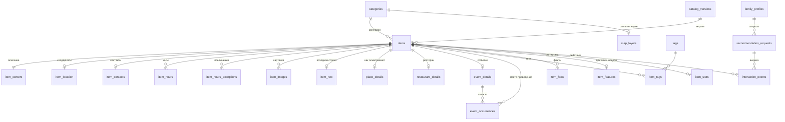

# Схема БД

Статус: реализовано в `db/migrations` (источник истины), загрузка данных — `cmd/dbload`. Охват: места и объекты из `main.csv`, объекты из `addition.csv`, рестораны, события, рекомендательная система.

## 1. Принципы

| Решение | Причина |
|---|---|
| Единая таблица `items` для всего, что может быть рекомендовано или показано на карте | Одни и те же картинки, теги, признаки, статистика и события взаимодействия работают для мест, ресторанов, событий и объектов карты без дублирования таблиц |
| Подтипы (`restaurant_details`, `event_details`) 1:1 с `items` | В основной таблице нет колонок, пустых для большинства строк |
| Объекты `addition` — это `items` с `show_in_cards = false` | Не попадают в карточки и выдачу, но участвуют в карте |
| Картинки на диске, в БД только метаданные и хеш | БД остаётся маленькой, дамп быстрым; файлы раздаются с долгим кэшем |
| Числовой `item_id` (4 байта) вместо текстового | Меньше строки, индексы и соединения. В API отдаётся строкой |
| Неизвестное значение = `NULL` или отсутствие строки | Не храним «unknown», не тратим место |

## 2. Инструменты

| Инструмент | Роль | Зачем именно он |
|---|---|---|
| PostgreSQL 16 | Основная БД | Транзакции, партиционирование, частичные индексы, встроенный полнотекстовый поиск (словарь `russian`). Заменяет файловый `state.json` |
| PostGIS | Координаты и карта | `geography(Point, 4326)`, GiST-индекс, `ST_DWithin` (радиус в метрах), выборка по границам карты |
| pgvector ≥ 0.7 | Векторы рекомендаций | Тип `halfvec` (2 байта на число, вдвое меньше `vector`), индекс HNSW для поиска похожих |
| pg_trgm | Поиск по названию | Нечёткий поиск с опечатками |
| goose или golang-migrate | Миграции | Версионируемая схема, применяется при деплое |
| pgx v5 | Драйвер Go | Нативный протокол, пул соединений, поддержка массивов и jsonb |
| libvips (bimg) | Обработка картинок | Быстрое изменение размера и конвертация в WebP |
| Файловая система | Хранение картинок | Раздача через backend с `ETag` и кэшем |
| pg_partman (опционально) | Партиции событий | Автоматическое создание и удаление месячных партиций |
| Valhalla | Маршруты | Уже в проекте; БД маршруты не считает |

Образ собирается в `infra/postgres/Dockerfile`: база `pgvector/pgvector:pg16` (amd64 и arm64) плюс PostGIS из репозитория PGDG. Официальный `postgis/postgis` не подходит: в нём нет pgvector, а образ 16-3.4 основан на устаревшем Debian bullseye.

## 3. Структура



Три слоя:

- **Показ:** `items`, `item_content`, `item_images`, `categories`. Фронт читает только их и выводит категорию, название, описание, картинку.
- **Хранение:** `item_location`, `item_contacts`, `item_hours*`, `item_raw`, `place_details`, `restaurant_details`, `event_details`, `event_occurrences`, `map_layers`.
- **Рекомендации:** `tags`, `item_tags`, `item_facts`, `item_features`, `item_stats`, `family_profiles`, `recommendation_requests`, `interaction_events`.

## 4. Схема

```sql
CREATE EXTENSION IF NOT EXISTS postgis;
CREATE EXTENSION IF NOT EXISTS vector;
CREATE EXTENSION IF NOT EXISTS pg_trgm;

CREATE TYPE item_type AS ENUM ('place', 'restaurant', 'event', 'map_object');
```

### 4.1 Справочники

```sql
CREATE TABLE catalog_versions (
  version     text PRIMARY KEY,                 -- версия загруженного каталога, например '2026-11-20'
  created_at  timestamptz NOT NULL DEFAULT now(),
  note        text
);

CREATE TABLE categories (
  category_id smallint PRIMARY KEY,
  item_type   item_type NOT NULL,               -- к какому типу относится категория
  slug        text NOT NULL,                    -- латинский код: 'museums'
  name_ru     text NOT NULL,                    -- название для пользователя: 'Музеи и выставочные центры'
  sort_order  smallint NOT NULL DEFAULT 0,      -- порядок в списках
  UNIQUE (item_type, slug),
  UNIQUE (item_type, name_ru)
);

CREATE TABLE map_layers (                       -- как категория рисуется на карте
  category_id    smallint PRIMARY KEY REFERENCES categories,
  icon           text NOT NULL,                 -- имя иконки маркера
  color          text NOT NULL CHECK (color ~ '^#[0-9A-Fa-f]{6}$'),  -- цвет подсветки
  min_zoom       smallint NOT NULL DEFAULT 10,  -- с какого масштаба объекты видны
  z_order        smallint NOT NULL DEFAULT 0,   -- порядок наложения
  is_highlighted boolean NOT NULL DEFAULT false,-- подсвечивать на карте (функционал обсуждается)
  is_active      boolean NOT NULL DEFAULT true  -- слой включён
);

CREATE TABLE tags (
  tag_id     smallint PRIMARY KEY,
  slug       text NOT NULL UNIQUE,              -- 'animals', 'italian'
  name_ru    text NOT NULL,
  tag_group  text NOT NULL
             CHECK (tag_group IN ('theme', 'activity', 'audience', 'cuisine', 'feature', 'object_kind'))
);
```

### 4.2 Основа: items

Колонки расставлены по убыванию размера, чтобы не терять место на выравнивании.

```sql
CREATE TABLE items (
  created_at      timestamptz NOT NULL DEFAULT now(),
  updated_at      timestamptz NOT NULL DEFAULT now(),
  item_id         integer GENERATED ALWAYS AS IDENTITY PRIMARY KEY,
                                                -- в API отдаётся строкой; стабилен при перезагрузке данных
  item_type       item_type NOT NULL,
  category_id     smallint NOT NULL REFERENCES categories,
  show_in_cards   boolean NOT NULL,             -- выводить как карточку (false для addition)
  show_on_map     boolean NOT NULL DEFAULT true,-- показывать на карте
  is_published    boolean NOT NULL DEFAULT true,-- мягкое скрытие без удаления
  title           text NOT NULL,
  source_dataset  text NOT NULL,                -- 'main', 'addition', 'restaurants', 'events'
  source_id       text NOT NULL,                -- id в исходном наборе
  catalog_version text NOT NULL REFERENCES catalog_versions,
  UNIQUE (source_dataset, source_id)            -- ключ идемпотентной загрузки
);
CREATE INDEX items_cards_idx ON items (item_type, category_id)
  WHERE is_published AND show_in_cards;
CREATE INDEX items_map_idx ON items (category_id)
  WHERE is_published AND show_on_map;
CREATE INDEX items_title_trgm_idx ON items USING gin (title gin_trgm_ops);

CREATE TABLE item_content (                     -- тяжёлый текст отдельно от горячей таблицы
  item_id          integer PRIMARY KEY REFERENCES items ON DELETE CASCADE,
  description_html text NOT NULL,               -- как в источнике (<p>, <br>), уходит на фронт
  search_vector    tsvector GENERATED ALWAYS AS (
                     to_tsvector('russian', regexp_replace(description_html, '<[^>]+>', ' ', 'g'))
                   ) STORED                     -- полнотекстовый поиск по описанию
);
CREATE INDEX item_content_fts_idx ON item_content USING gin (search_vector);

CREATE TABLE item_raw (                         -- исходная строка для аудита и пересборки
  item_id     integer PRIMARY KEY REFERENCES items ON DELETE CASCADE,
  raw         jsonb NOT NULL,                   -- строка CSV целиком
  source_file text NOT NULL,
  loaded_at   timestamptz NOT NULL DEFAULT now()
);
```

### 4.3 Местоположение, контакты, часы работы

```sql
CREATE TABLE item_location (                    -- у событий нет: место берётся из event_occurrences
  item_id   integer PRIMARY KEY REFERENCES items ON DELETE CASCADE,
  location  geography(Point, 4326) NOT NULL,    -- из WKT 'POINT (lon lat)'
  entrance  geography(Point, 4326),             -- точка входа, если отличается от центра
  address   text NOT NULL,
  district  text                                -- район города
);
CREATE INDEX item_location_gix ON item_location USING gist (location);

CREATE TABLE item_contacts (
  item_id  integer PRIMARY KEY REFERENCES items ON DELETE CASCADE,
  phone    text,
  website  text
);

CREATE TABLE item_hours (                       -- регулярный график
  item_id  integer NOT NULL REFERENCES items ON DELETE CASCADE,
  weekday  smallint NOT NULL CHECK (weekday BETWEEN 1 AND 7),  -- 1 = понедельник
  opens    time NOT NULL,
  closes   time NOT NULL,                       -- closes <= opens: закрытие после полуночи
  PRIMARY KEY (item_id, weekday, opens)         -- несколько интервалов в день допустимы
);

CREATE TABLE item_hours_exceptions (            -- праздники и особые дни
  item_id  integer NOT NULL REFERENCES items ON DELETE CASCADE,
  on_date  date NOT NULL,
  is_open  boolean NOT NULL,
  opens    time,
  closes   time,
  note     text,
  PRIMARY KEY (item_id, on_date)
);
```

### 4.4 Картинки

В БД только метаданные. Сами файлы лежат на диске и адресуются по хешу.

```sql
CREATE TABLE item_images (
  image_id    integer GENERATED ALWAYS AS IDENTITY PRIMARY KEY,
  item_id     integer NOT NULL REFERENCES items ON DELETE CASCADE,
  sha256      bytea NOT NULL CHECK (octet_length(sha256) = 32),
                                                -- хеш оригинала: имя файла, ETag, защита от дублей
  width       smallint NOT NULL,                -- размер оригинала, px
  height      smallint NOT NULL,
  sort_order  smallint NOT NULL DEFAULT 0,
  is_cover    boolean NOT NULL DEFAULT false,   -- обложка карточки
  alt_text    text,
  source_url  text,                             -- откуда получена
  author      text,
  license     text,                             -- на каком праве используется
  UNIQUE (item_id, sha256)
);
CREATE UNIQUE INDEX item_images_cover_uidx ON item_images (item_id) WHERE is_cover;
CREATE INDEX item_images_item_idx ON item_images (item_id, sort_order);
```

Хранение на диске:

```
{IMAGES_ROOT}/ab/cd/abcd…ef_thumb.webp    -- 160 px по длинной стороне
{IMAGES_ROOT}/ab/cd/abcd…ef_card.webp     -- 640 px
{IMAGES_ROOT}/ab/cd/abcd…ef_full.webp     -- 1600 px
```

- Путь вычисляется из `sha256` (первые два байта, hex). Пути в БД не хранятся, поэтому каталог можно переносить.
- Имя файла = хеш содержимого: файл неизменяем, дубликаты не создаются, кэш бессрочный.
- Эндпоинт `GET /api/v1/images/{image_id}/{variant}` отдаёт файл с `ETag: "<sha256>"` и `Cache-Control: public, max-age=31536000, immutable`.
- Все три размера создаются при загрузке (libvips); в БД не записываются, их набор фиксирован в коде.
- Каталог с картинками монтируется как Docker volume. Резервная копия — `pg_dump` плюс копия каталога. Периодическая проверка находит строки без файлов и файлы без строк.

### 4.5 Подтипы: места, рестораны и события

```sql
CREATE TABLE place_details (                    -- как объект осматривают: снаружи или внутри
  item_id              integer PRIMARY KEY REFERENCES items ON DELETE CASCADE,
  visit_mode           text CHECK (visit_mode IN ('outdoor', 'indoor', 'both')),
                                                -- outdoor: только снаружи (памятник, набережная, парк)
                                                -- indoor: только внутри (музей, театр)
                                                -- both: можно и снаружи, и внутри (храм, кремль)
                                                -- NULL: ещё не размечено
  outside_only_ok      boolean,                 -- достаточно осмотреть снаружи
  open_access          boolean,                 -- можно подойти в любое время, графика нет
  ticket_required      boolean,                 -- для входа внутрь нужен билет
  outside_duration_min smallint CHECK (outside_duration_min > 0),  -- осмотр снаружи
  inside_duration_min  smallint CHECK (inside_duration_min > 0)    -- посещение внутри
);                                              -- вид объекта хранится тегами с tag_group = 'object_kind'

CREATE TABLE restaurant_details (
  item_id               integer PRIMARY KEY REFERENCES items ON DELETE CASCADE,
  avg_check_rub         integer,                -- средний чек на человека
  price_level           smallint CHECK (price_level BETWEEN 1 AND 4),  -- 1 дёшево … 4 дорого
  play_area_min_age     smallint,               -- возрастные границы детской зоны
  play_area_max_age     smallint,
  children_menu         boolean,                -- детское меню
  small_portions        boolean,                -- маленькие порции
  high_chairs           boolean,                -- детские стулья
  changing_table        boolean,                -- пеленальный столик
  play_area             boolean,                -- есть детская зона
  play_area_supervision boolean,                -- присмотр в детской зоне
  takes_reservations    boolean                 -- принимает бронь
);                                              -- кухня хранится тегами с tag_group = 'cuisine'

CREATE TABLE event_details (                    -- событие как сущность: спектакль, концерт, выставка
  item_id           integer PRIMARY KEY REFERENCES items ON DELETE CASCADE,
  duration_min      smallint,                   -- длительность одного сеанса
  age_rating        smallint CHECK (age_rating IN (0, 6, 12, 16, 18)),
  booking_required  boolean,
  organizer         text,
  ticket_url        text
);

CREATE TABLE event_occurrences (                -- конкретные даты и места проведения
  occurrence_id  bigint GENERATED ALWAYS AS IDENTITY PRIMARY KEY,
  starts_at      timestamptz NOT NULL,
  ends_at        timestamptz,
  event_id       integer NOT NULL REFERENCES event_details ON DELETE CASCADE,
  venue_id       integer NOT NULL REFERENCES items,   -- место проведения (item типа place)
  price_min_rub  integer,
  price_max_rub  integer,
  status         text NOT NULL DEFAULT 'scheduled'
                 CHECK (status IN ('scheduled', 'cancelled')),
  booking_status text NOT NULL DEFAULT 'unknown'
                 CHECK (booking_status IN ('available', 'sold_out', 'unknown'))
);
CREATE INDEX event_occurrences_time_idx  ON event_occurrences (starts_at) WHERE status = 'scheduled';
CREATE INDEX event_occurrences_event_idx ON event_occurrences (event_id, starts_at);
CREATE INDEX event_occurrences_venue_idx ON event_occurrences (venue_id, starts_at);
```

Прошедшие сеансы переносятся в архив фоновой задачей.

### 4.6 Теги и факты

```sql
CREATE TABLE item_tags (
  item_id  integer  NOT NULL REFERENCES items ON DELETE CASCADE,
  tag_id   smallint NOT NULL REFERENCES tags,
  weight   real NOT NULL DEFAULT 1 CHECK (weight BETWEEN 0 AND 1),  -- насколько тег характерен
  PRIMARY KEY (item_id, tag_id)
);
CREATE INDEX item_tags_tag_idx ON item_tags (tag_id, item_id);

CREATE TABLE item_facts (                       -- проверяемые факты с происхождением (Fact<T> из контракта)
  item_id       integer NOT NULL REFERENCES items ON DELETE CASCADE,
  fact_key      text NOT NULL,                  -- см. список ниже
  value         jsonb NOT NULL,                 -- true / false / число
  source        text NOT NULL CHECK (source IN ('official', 'osm', 'estimated', 'user', 'model')),
  confidence    real CHECK (confidence BETWEEN 0 AND 1),
  evidence_ids  text[] NOT NULL DEFAULT '{}',   -- ссылки на подтверждения
  updated_at    timestamptz NOT NULL DEFAULT now(),
  PRIMARY KEY (item_id, fact_key)
);
```

Отсутствие строки означает «неизвестно».

Ключи `fact_key`: `indoor`, `toilet`, `shelter`, `seating`, `stroller_friendly`, `wheelchair_accessible`, `changing_table`, `age_min_years`, `age_max_years`, `recommended_age_min_years`, `recommended_age_max_years`, `height_min_cm`, `admission_rule`, `booking_required`, `duration_min`, `visit_mode`.

### 4.7 Рекомендательная система

```sql
CREATE TABLE item_features (                    -- признаки для ранжирования; пересчитываются из фактов
  item_id             integer PRIMARY KEY REFERENCES items ON DELETE CASCADE,
  computed_at         timestamptz NOT NULL DEFAULT now(),
  quality_score       real,                     -- общая оценка качества, 0–1
  embedding           halfvec(384),             -- вектор описания; размерность зависит от модели
  duration_min        smallint,                 -- сколько обычно занимает посещение
  age_min             smallint,                 -- разрешённый возраст
  age_max             smallint,
  age_rec_min         smallint,                 -- рекомендуемый возраст
  age_rec_max         smallint,
  price_level         smallint CHECK (price_level BETWEEN 0 AND 4),  -- 0 бесплатно … 4 дорого
  physical_load       smallint CHECK (physical_load BETWEEN 1 AND 5),-- 1 спокойно … 5 много ходьбы
  season_mask         smallint NOT NULL DEFAULT 15,  -- биты: 1 зима, 2 весна, 4 лето, 8 осень
  daypart_mask        smallint NOT NULL DEFAULT 7,   -- биты: 1 утро, 2 день, 4 вечер
  indoor              boolean,                  -- в помещении
  shelter             boolean,                  -- есть укрытие от дождя
  toilet              boolean,
  seating             boolean,
  stroller_friendly   boolean,
  wheelchair_accessible boolean,
  changing_table      boolean,
  embedding_model     text,
  features_version    text NOT NULL
);
CREATE INDEX item_features_embedding_idx ON item_features
  USING hnsw (embedding halfvec_cosine_ops);

CREATE TABLE item_stats (                       -- агрегаты поведения; часто обновляются
  item_id      integer PRIMARY KEY REFERENCES items ON DELETE CASCADE,
  updated_at   timestamptz NOT NULL DEFAULT now(),
  popularity   real NOT NULL DEFAULT 0,         -- с затуханием по времени, 0–1
  impressions  integer NOT NULL DEFAULT 0,      -- показы
  clicks       integer NOT NULL DEFAULT 0,
  saves        integer NOT NULL DEFAULT 0,      -- добавления в избранное
  in_trips     integer NOT NULL DEFAULT 0,      -- попадания в поездки
  ctr          real GENERATED ALWAYS AS (clicks::real / NULLIF(impressions, 0)) STORED
) WITH (fillfactor = 70);                       -- запас в страницах для быстрых обновлений

CREATE TABLE family_profiles (                  -- накопленные предпочтения гостевой сессии
  session_id          uuid PRIMARY KEY,         -- совпадает с гостевой сессией API
  updated_at          timestamptz NOT NULL DEFAULT now(),
  interest_embedding  halfvec(384),             -- усреднённый вектор интересов
  tag_weights         jsonb NOT NULL DEFAULT '{}',   -- {"tag_id": вес}
  child_ages          smallint[] NOT NULL DEFAULT '{}'
);

CREATE TABLE recommendation_requests (          -- контекст хранится один раз на выдачу
  request_id     uuid PRIMARY KEY,
  created_at     timestamptz NOT NULL DEFAULT now(),
  session_id     uuid NOT NULL,
  model_version  text NOT NULL,                 -- какая модель сформировала выдачу
  context        jsonb NOT NULL DEFAULT '{}'    -- возраст детей, время, погода, позиция на карте
);
CREATE INDEX recommendation_requests_session_idx ON recommendation_requests (session_id, created_at);

CREATE TABLE interaction_events (               -- сырые события для обучения; партиции по месяцам
  created_at  timestamptz NOT NULL DEFAULT now(),
  event_id    bigint GENERATED ALWAYS AS IDENTITY,
  item_id     integer NOT NULL REFERENCES items,
  session_id  uuid NOT NULL,
  request_id  uuid,
  kind        smallint NOT NULL CHECK (kind BETWEEN 1 AND 6),
                                                -- 1 показ, 2 клик, 3 сохранение, 4 добавление в поездку, 5 пропуск, 6 скрытие
  position    smallint,                         -- позиция в выдаче
  PRIMARY KEY (created_at, event_id)
) PARTITION BY RANGE (created_at);
CREATE INDEX interaction_events_item_idx    ON interaction_events (item_id, created_at);
CREATE INDEX interaction_events_session_idx ON interaction_events (session_id, created_at);

-- DEFAULT-партиция принимает события вне созданных диапазонов, чтобы запись не падала.
CREATE TABLE interaction_events_default PARTITION OF interaction_events DEFAULT;
-- Месячные партиции (в миграции созданы 2026-11 … 2027-01, дальше добавляются по мере необходимости).
CREATE TABLE interaction_events_2026_11 PARTITION OF interaction_events
  FOR VALUES FROM ('2026-11-01') TO ('2026-12-01');
```

Что используется рекомендательной системой:

- **Кандидаты:** `items` + `item_location` (радиус вокруг точки) + `item_hours` и `event_occurrences` (открыто или идёт в нужное время).
- **Допуск по семье:** `item_features` (`age_*`, `stroller_friendly`, `physical_load`) и `family_profiles.child_ages`.
- **Релевантность:** косинусная близость `item_features.embedding` и `family_profiles.interest_embedding`, пересечение `item_tags` с `tag_weights`.
- **Поправки:** `item_stats.popularity`, `quality_score`, сезон и время суток по `season_mask` и `daypart_mask`.
- **Обучение и оценка:** `interaction_events` вместе с `recommendation_requests` (какая модель, в каком контексте, на какой позиции).

## 5. Объекты `addition`

Мозаика, тактильные объекты и города-побратимы в карточках не выводятся и в рекомендации не попадают.

| Поле | Значение |
|---|---|
| `items.item_type` | `map_object` |
| `items.show_in_cards` | `false` |
| `items.show_on_map` | `true` |
| `items.category_id` | категории `Мозаика`, `Тактильный объект`, `Города-побратимы` |
| Внешний вид на карте | `map_layers` по `category_id` |
| Хранятся | `item_location`, `item_content`, `item_raw`, `item_images` |
| Не заполняются | `item_features`, `item_stats`, `item_tags`, `item_facts` |

Запрос для карты по границам видимой области:

```sql
SELECT i.item_id, i.title, ST_Y(l.location::geometry) AS lat, ST_X(l.location::geometry) AS lon,
       m.icon, m.color, m.is_highlighted
FROM items i
JOIN item_location l USING (item_id)
JOIN map_layers m USING (category_id)
WHERE i.is_published AND i.show_on_map AND m.is_active AND m.min_zoom <= $zoom
  AND l.location && ST_MakeEnvelope($west, $south, $east, $north, 4326)::geography;
```

Так как объекты `addition` лежат в общих таблицах, их можно в любой момент включить в карточки или рекомендации сменой флага `show_in_cards`.

## 6. Запрос карточек

Фронт получает категорию, название, описание и ссылку на картинку. Всё остальное остаётся в БД.

```sql
SELECT i.item_id,
       i.title,
       c.name_ru           AS category,
       ic.description_html AS description,
       img.image_id        AS cover_image_id    -- URL: /api/v1/images/{id}/card
FROM items i
JOIN categories c   USING (category_id)
JOIN item_content ic USING (item_id)
LEFT JOIN item_images img ON img.item_id = i.item_id AND img.is_cover
WHERE i.item_id = ANY ($1)                      -- id, выбранные рекомендательной системой
  AND i.is_published AND i.show_in_cards;
```

## 7. Соответствие источникам

| Колонка `main.csv` / `addition.csv` | Куда |
|---|---|
| `id` | `items.source_id`, `items.source_dataset` = `main` или `addition` |
| `title` | `items.title` |
| `category` | `categories` → `items.category_id` |
| `description` | `item_content.description_html` |
| `address` | `item_location.address` |
| `coordinate` (`POINT (lon lat)`) | `item_location.location` через `ST_GeogFromText` |
| строка целиком | `item_raw.raw` |
| не заполняется из CSV | картинки, часы, контакты, теги, факты, признаки, статистика |

## 8. Правила эффективности

- Горячие таблицы (`items`, `item_stats`) узкие. Текст описаний, исходные строки и контакты вынесены отдельно.
- Колонки расположены от широких к узким и от фиксированных к переменным, чтобы не терять место на выравнивании.
- Идентификаторы — `integer` и `smallint`; `bigint` только там, где строк будет много (`event_id`, `occurrence_id`).
- Частичные индексы (`WHERE is_published AND show_in_cards`) меньше и быстрее полных.
- Векторы хранятся как `halfvec(384)`: 768 байт вместо 1536 на строку.
- Битовые маски (`season_mask`, `daypart_mask`) вместо массивов или отдельных таблиц.
- Контекст выдачи пишется один раз в `recommendation_requests`, а не в каждое событие.
- `interaction_events` партиционирована по месяцам: старые данные удаляются или архивируются отсоединением партиции, запросы по времени читают только нужные партиции.
- `item_stats` создана с `fillfactor = 70`, обновления счётчиков проходят без раздувания таблицы.
- Загрузка идемпотентна: `INSERT … ON CONFLICT (source_dataset, source_id) DO UPDATE`.

## 9. Запуск

```bash
cp .env.example .env                     # задайте POSTGRES_PASSWORD (и POSTGRES_PORT, если 5432 занят)
docker compose up -d --wait postgres
docker compose run --rm migrate up       # применить миграции
docker compose run --rm migrate down     # откатить последнюю
go run ./cmd/dbload                      # загрузить db/seed/main.csv и addition.csv (нужен DATABASE_URL)
```

Миграции (goose, `db/migrations`):

| Файл | Содержимое |
|---|---|
| `00001_extensions_types` | postgis, vector, pg_trgm, тип `item_type` |
| `00002_dictionaries` | `catalog_versions`, `categories`, `map_layers`, `tags` |
| `00003_items` | `items`, `item_content`, `item_raw` |
| `00004_location_hours` | `item_location`, `item_contacts`, `item_hours`, `item_hours_exceptions` |
| `00005_images` | `item_images` |
| `00006_subtypes` | `place_details`, `restaurant_details`, `event_details`, `event_occurrences` |
| `00007_tags_facts` | `item_tags`, `item_facts` |
| `00008_recommender` | `item_features`, `item_stats`, `family_profiles`, `recommendation_requests`, `interaction_events` с партициями |
| `00009_seed_dictionaries` | категории, стили карты, виды объектов, версия каталога |

Загрузчик `cmd/dbload` идемпотентен и при повторном запуске не перезаписывает то, что правят вручную: `show_in_cards`, `show_on_map`, `is_published` и размеченный `place_details`. Для `main` он ставит начальный `visit_mode` по категории (Памятники и Набережные: outdoor с `open_access`; Парки: outdoor; Музеи и Театры: indoor с билетом). «Достопримечательности» и «Культурно-развлекательные организации» остаются неразмеченными.

Следующие шаги: загрузчик картинок и эндпоинты картинок и карточек, загрузчики ресторанов и событий, заполнение тегов, фактов и `item_features`, запись `interaction_events`.

## 10. Открытые вопросы

- Источник картинок: в датасетах их нет. Пока файлов нет, фронт получает `cover_image_id = null`.
- Источники данных по ресторанам и событиям и их формат.
- Размерность эмбеддинга (`384`) выбрана условно, зависит от модели.
- Какие слои карты подсвечиваются и как (`map_layers.is_highlighted`).
- Перечень тегов и их группы.
